<div align="center">


# Anivexa API (`lightanime-api`)

**High-Performance Anime Streaming Aggregator & Identity Proxy for Cloudflare Workers and Node.js**

[](https://workers.cloudflare.com/)
[](https://nodejs.org/)
[](https://developer.mozilla.org/en-US/docs/Web/JavaScript/Guide/Modules)
[](LICENSE)

[API Reference](#api-reference) • [Architecture](#system-architecture) • [Providers](#provider-matrix) • [Extractors & Cryptography](#cryptographic-extractors) • [Deployment](#deployment--cloudflare-workers)

</div>

---

## Overview

**Anivexa API** (`lightanime-api`) is an anime streaming aggregator and cross-platform identity mapping proxy. It consolidates **12 independent anime streaming providers** and **7 cryptographic video extractors** behind a unified, standard REST interface anchored by **AniList IDs**.

Give the API a single AniList ID, and it concurrently queries upstream sources, aligns franchise seasons, resolves episode numbers, and returns direct playable video streams (HLS `.m3u8`, MP4, DASH), subtitle tracks, and video headers.

Designed to execute at the edge on **Cloudflare Workers** (the V8-isolate `workerd` runtime) with zero binary dependencies, it also functions as a standalone Node.js server.

> [!IMPORTANT]
> **AniList Identity Layer**: This API intentionally uses AniList as its primary catalog and identity anchor. When AniList is unavailable, downstream lookups and relations may be degraded.

---

## System Architecture

```mermaid
flowchart TD
    Client([Client / Frontend SPA]) -->|HTTP / Service Binding| Gateway["Cloudflare Worker Entry (index.js)\nCORS, Routing & In-Flight Deduplication"]

    subgraph CoreServices ["Core Services Layer"]
        Gateway --> Router{"Route Match"}
        Router -->|/map/:id| Mapper["core/mapper.js\nARM v2 + AniList Relations"]
        Router -->|/episodes/:id| Strategy["core/episode-strategy.js\nConcurrent Provider Aggregation"]
        Router -->|/watch/:p/:id/...| Watcher["Stream Resolution Engine"]
        Router -->|/m3u8-proxy| Proxy["Built-in M3U8 CORS Proxy"]
    end

    subgraph CachingLayer ["Multi-Tier Caching System (core/smartcache.js)"]
        Strategy <--> SmartCache["Smart Cache Engine"]
        SmartCache --> L1["L1: In-Memory Map (LRU, 800 entries)"]
        SmartCache --> L2KV["L2: Cloudflare KV (env.CACHE_KV)"]
        SmartCache --> L2Redis["L2: Upstash Redis REST API"]
        SmartCache -.-> Background["ctx.waitUntil Background Stale Revalidation"]
    end

    subgraph ProvidersLayer ["12 Source Providers (providers/)"]
        Strategy --> P1["kaa (KickAssAnime)"]
        Strategy --> P2["anikoto (AniKoto / MegaPlay)"]
        Strategy --> P3["reanime (ReAnime / FlixCloud)"]
        Strategy --> P4["aniwaves (AniWaves / DataSv)"]
        Strategy --> P5["anizone (AniZone)"]
        Strategy --> P6["senshi (Senshi / VidCloud)"]
        Strategy --> P7["animegg (AnimeGG)"]
        Strategy --> P8["animenosub (AnimeNoSub)"]
        Strategy --> P9["mkissa (MKissa)"]
        Strategy --> P10["animedunya (AnimeDunya)"]
        Strategy --> P11["animeonsen (AnimeOnsen)"]
        Strategy --> P12["anipm (Ani.pm)"]
    end

    subgraph ExtractorsLayer ["Cryptographic Extractors (extractors/)"]
    Watcher --> E1["flixcloud.js (WASM LEB128 + XOR)"]
    Watcher --> E2["megaplay.js (AES-CBC + HMAC)"]
    Watcher --> E3["byse.js (WebCrypto ECDH + Block Mix)"]
    Watcher --> E4["datasv.js (MP4 Direct Video)"]
    Watcher --> E5["vidplay.js (Encrypted Embeds)"]
    Watcher --> E6["nova.js (AES-128-CBC)"]
    Watcher --> E7["vidmoly.js (Master M3U8 Extraction)"]
    end
```



---

## Edge Runtime & Cloudflare Architecture

Anivexa API is engineered for Cloudflare Workers:

1. **V8 Isolate Compatibility**:
   - Zero native binaries: Replaced `wreq-js` native Rust addons with a web-standard `fetch` session engine that preserves browser headers and cookie state.
   - Zero filesystem dependency: Replaced `node:fs` calls with in-memory and edge storage bindings.
   - Pure async HTTP: Removed `node:child_process` and `node:vm` execution, replacing them with standard fetch and capability guards.
2. **Cloudflare Service Binding Security**:
   - By setting `workers_dev = false` and `preview_urls = false`, the API is completely private from the public web.
   - Securely bound to the frontend Worker (`aenime`) via `[[services]] binding = "API"`. Requests are transmitted directly between isolates within Cloudflare’s global network with zero external latency and no token overhead.
3. **Background Workloads via `ctx.waitUntil`**:
   - Updates cache entries asynchronously without delaying client responses.
   - Automatically revalidates episode lists when new episodes air based on AniList broadcast countdowns.

---

## Provider Matrix

| Provider Key | Display Name | Upstream Base | Protocols | Audio | Extraction / Encryption | Matching Mechanism |
|---|---|---|---|---|---|---|
| `kaa` | KickAssAnime | `https://kaa.lt` | HLS | SUB, DUB | Direct HLS master | Title search + fuzzy scoring |
| `anikoto` | AniKoto | `https://anikototv.to` | HLS | SUB, DUB | MegaPlay (AES-CBC, HMAC) | Nekostream mapping + AniZip |
| `reanime` | ReAnime | `https://reanime.to` | HLS | SUB, DUB | FlixCloud (WASM LEB128, XOR) | Cover image regex + title search |
| `aniwaves` | AniWaves | `https://aniwaves.to` | HLS, MP4 | SUB, DUB | DataSv, MegaPlay, Vidplay | Title search + alias resolution |
| `anizone` | AniZone | `https://anizone.to` | HLS | SUB, DUB | HLS master + WebVTT subtitles | Title search + episode count |
| `senshi` | Senshi | `https://senshi.to` | HLS | SUB, DUB | VidCloud (`s.vidcloud.se`) | Direct MyAnimeList ID |
| `animegg` | AnimeGG | `https://www.animegg.org` | HLS, MP4 | SUB, DUB | Direct video feeds | Dice coefficient title matching |
| `animenosub` | AnimeNoSub | `https://animenosub.to` | HLS | SUB, DUB | Vidmoly, Byse, DataSv, Nova | Tokenized search matching |
| `mkissa` | MKissa | `https://kisskisa.com` | HLS | SUB, DUB | Custom AES cipher + captcha | Title search + season markers |
| `animedunya` | AnimeDunya | `https://anime-dunya.com` | HLS | SUB, DUB | Embed video scraper | Direct MyAnimeList ID |
| `animeonsen` | AnimeOnsen | `https://www.animeonsen.xyz` | DASH, HLS | SUB | Session cookie + meta token | AniList ID + MAL ID |
| `anipm` | Ani.pm | `https://ani.pm` | HLS | SUB, DUB | Settlar embed (`embed.settlar.io`) | AniList ID + MAL ID |

---

## Cryptographic Extractors

The API includes custom video decoders under `extractors/`:

### 1. FlixCloud (`extractors/flixcloud.js`)
ReAnime utilizes FlixCloud for high-bitrate HLS streams. FlixCloud manifests can be returned as Base64-encoded, XOR-encrypted payloads:
- **WASM Decryption**: Parses the WebAssembly bytecode sections using LEB128 integer decoding to extract the XOR playlist decryption key.
- **Segment Unwrapping**: Handles image-steganography wrapped video segments (`.webp` and `.png` headers), unwrapping raw MPEG-TS video bytes via XOR masking.

<details>
<summary>Click to view FlixCloud manifest decryption implementation</summary>

```javascript
export function decryptFlixManifest(bodyBuffer, playlistKey) {
  const raw = Buffer.isBuffer(bodyBuffer) ? bodyBuffer : Buffer.from(bodyBuffer);
  const trimmed = raw.toString("utf8").trim();

  if (trimmed.startsWith("#EXTM3U")) return trimmed;

  const key = Buffer.from(playlistKey, "base64");
  let payload = Buffer.from(trimmed, "base64");
  const out = Buffer.alloc(payload.length);

  for (let i = 0; i < payload.length; i++) {
    out[i] = payload[i] ^ key[i % key.length];
  }

  const text = out.toString("utf8").trim();
  if (!text.startsWith("#EXTM3U")) throw new Error("FlixCloud manifest decrypt failed");
  return text;
}
```
</details>

### 2. MegaPlay (`extractors/megaplay.js`)
- Resolves sources from `megaplay.*` embeds.
- Parses script payloads, extracts encrypted strings, and decrypts stream URLs using **AES-256-CBC**.
- Generates **HMAC SHA-256** signatures to authenticate segment requests.

### 3. Byse (`extractors/byse.js`)
- Modern **WebCrypto** key derivation and ECDH handshakes.
- Performs custom byte-shifting block permutations (`mix`, `hash`) to extract direct HLS manifests.

### 4. DataSv (`extractors/datasv.js`)
- Extracts MP4 video URLs from `play.echovideo.ru/embed-20/`.
- Surfaces direct MP4 files that can be rendered inside `<video>` elements with `referrerpolicy="no-referrer"`.

---

## API Reference

### Base URL
- **Local Dev Server**: `http://localhost:4000`
- **Cloudflare Service Binding**: `env.API` (from frontend Worker)
- **Direct Edge (if enabled)**: `https://<your-worker>.workers.dev`

---

### 1. API Status & Landing Page
```http
GET /
```
- **Browser Requests (`Accept: text/html`)**: Serves the visual documentation landing page.
- **API Clients (`Accept: application/json`)**: Returns JSON server status.

#### Example Response:
```json
{
  "status": "online",
  "version": "2.3",
  "runtime": "Cloudflare Workers",
  "cacheEnabled": true,
  "providers": ["mkissa", "reanime", "anikoto", "animegg", "animenosub", "anizone", "aniwaves", "senshi", "kaa", "animedunya", "animeonsen", "anipm"],
  "routes": {
    "map": "/map/:anilistId",
    "episodes": "/episodes/:anilistId",
    "watch": "/watch/:provider/:anilistId/(sub|dub)/:provider-:ep",
    "streamRedirect": "/stream/reanime/:id/(sub|dub)/:ep",
    "m3u8Proxy": "/m3u8-proxy?url=..."
  }
}
```

---

### 2. Cross-Platform ID Mapping
```http
GET /map/:anilistId
```
Fetches ID mappings across MyAnimeList, TheTVDB, TheMovieDB, Kitsu, AniDB, Simkl, and Anime-Planet using ARM v2 and AniList franchise relations.

#### Example Request:
```bash
curl http://localhost:4000/map/21
```

#### Example Response:
```json
{
  "mappings": {
    "id": 21,
    "title": "ONE PIECE",
    "type": "tv",
    "format": "TV",
    "episodes": null,
    "malId": 21,
    "aniId": 21,
    "anidbId": 69,
    "animePlanetId": "one-piece",
    "kitsuId": 12,
    "imdbId": "tt0388629",
    "themoviedbId": 37854,
    "thetvdbId": 81797,
    "synonyms": ["OP"],
    "franchise": []
  }
}
```

---

### 3. Aggregated Episode Lists
```http
GET /episodes/:anilistId
```
Concurrently queries all 12 providers for the given AniList ID, parses AniZip metadata (titles, episode thumbnails, filler flags), and returns SUB and DUB episode arrays.

```http
GET /episodes/:provider[/:provider...]/:anilistId?map=true|false
```
Filters the lookup to one or more specific providers (e.g. `/episodes/kaa/anikoto/21`).

#### Example Request:
```bash
curl http://localhost:4000/episodes/kaa/anikoto/21
```

#### Example Response:
```json
{
  "page": 1,
  "type": "filtered",
  "mappings": { "malId": 21, "aniId": 21 },
  "kaa": {
    "meta": { "title": "One Piece", "provider": "kaa" },
    "episodes": {
      "sub": [
        { "number": 1, "title": "I'm Luffy! The Man Who Will Become the Pirate King!", "filler": false, "thumbnail": "https://..." }
      ],
      "dub": [
        { "number": 1, "title": "I'm Luffy! The Man Who Will Become the Pirate King!", "filler": false }
      ]
    }
  },
  "anikoto": {
    "meta": { "title": "One Piece", "provider": "anikoto" },
    "episodes": {
      "sub": [ ... ],
      "dub": [ ... ]
    }
  }
}
```

---

### 4. Stream Link Extraction
```http
GET /watch/:provider/:anilistId/(sub|dub)/:provider-:ep
```
Extracts stream links, formats, quality options, subtitle files, and necessary headers for playback.

#### Parameters:
- `provider`: One of the 12 active providers (`kaa`, `anikoto`, `reanime`, `aniwaves`, etc.).
- `anilistId`: Numeric AniList ID (e.g. `21`).
- `audio`: Audio track, either `sub` or `dub`.
- `episode`: Episode identifier in the format `:provider-:epNum` (e.g. `kaa-1`, `anikoto-100`).

#### Example Request:
```bash
curl http://localhost:4000/watch/kaa/21/sub/kaa-1
```

#### Example Response:
```json
{
  "anilistId": 21,
  "episode": 1,
  "audio": "sub",
  "provider": "kaa",
  "streams": [
    {
      "url": "https://krussdomi.com/hls/one-piece/01/master.m3u8",
      "type": "hls",
      "quality": "auto",
      "server": "KickAssAnime",
      "headers": {
        "Referer": "https://kaa.lt/",
        "User-Agent": "Mozilla/5.0"
      },
      "subtitles": [
        { "url": "https://.../sub-en.vtt", "label": "English", "srclang": "en" }
      ]
    }
  ]
}
```

---

### 5. Built-in M3U8 CORS Stream Proxy
```http
GET /m3u8-proxy?url=:encodedUrl&headers=:encodedHeadersJson
```
Proxies HLS manifests (`.m3u8`) and transport stream media chunks (`.ts`) to bypass CORS and Referer restrictions. Rewrites relative URLs inside `#EXTM3U` playlists to route back through the proxy automatically.

---

### 6. ReAnime Direct 302 Stream Redirect
```http
GET /stream/reanime/:id/(sub|dub)/:ep
```
Performs resolution in the background and issues an HTTP `302 Found` redirecting directly to the upstream video stream.

---

## Caching Strategy

The caching system (`core/smartcache.js` + `core/episode-cache.js`) implements a multi-tier caching model:

1. **L1 In-Memory Cache**: Fast in-isolate Map (800 entry limit with FIFO/LRU eviction).
2. **L2 Edge KV Cache**: Cloudflare KV (`env.CACHE_KV`) providing zero-latency distributed caching across edge data centers.
3. **L2 Upstash Redis REST**: Optional fallback for persistent storage over HTTPS REST.
4. **Dynamic TTL Policies**:
   - `FINISHED` anime: 7 days for episodes, 30 days for ID mappings.
   - `RELEASING` anime: 2 hours with a 15-minute background refresh.
   - Near-airing window: 5-minute probe interval when approaching `nextAiringEpisode.airingAt`.
   - Streaming URLs: 3 hours for persistent HLS links (or 60 seconds for signed session streams).
5. **In-Flight Request Deduplication**: Prevents cache thundering herd by deduplicating identical concurrent promises in memory.

---

## Environment Variables

Copy `.env.example` to `.env` for local development:

| Variable | Type | Default | Description |
|---|---|---|---|
| `API_VERSION` | String | `"2.3"` | Active API version reported in `/` response. |
| `PORT` | Number | `4000` | Local development port (`server.js`). |
| `CACHE_ENABLED` | Boolean | `false` | Enable/disable multi-tier caching. |
| `DEFAULT_REDIS_TTL` | Number | `900` | Default cache TTL in seconds. |
| `UPSTASH_REDIS_REST_URL` | String | `""` | Optional Upstash Redis REST endpoint. |
| `UPSTASH_REDIS_REST_TOKEN` | String | `""` | Optional Upstash Redis REST token. |
| `MKISSA_WREQ_REQUIRED` | String | `"0"` | Set `"1"` to enforce wreq on MKissa requests. |
| `SENSHI_WREQ_BROWSER` | String | `"chrome_149"` | Browser profile for Senshi TLS fingerprinting. |

---

## Local Development & Testing

### 1. Installation
```bash
git clone https://github.com/walterwhite-69/Anivexa-API.git
cd lightanime-api
npm install
```

### 2. Run Local Node Server
```bash
node server.js
```
The server will start at [http://localhost:4000](http://localhost:4000).

### 3. Run with Cloudflare Wrangler Emulator
```bash
npx wrangler dev
```

---

## Deployment — Cloudflare Workers

Anivexa API is configured to deploy as a private Worker Service:

### `wrangler.toml` Configuration:
```toml
name = "lightanime-api"
main = "index.js"
compatibility_date = "2026-10-08"
compatibility_flags = ["nodejs_compat"]
workers_dev = false
preview_urls = false

[dev]
port = 4000

[vars]
API_VERSION = "2.3"
CACHE_ENABLED = "false"
DEFAULT_REDIS_TTL = "900"
```

### Deploy to Production:
```bash
npx wrangler deploy
```

> [!TIP]
> Setting `workers_dev = false` ensures your API is **not** exposed to the public internet on `*.workers.dev`. It is accessible exclusively through Cloudflare Service Bindings from your frontend application (`aenime`), preventing unauthorized use and traffic scraping.

---

## License

This project is licensed under the MIT License.
